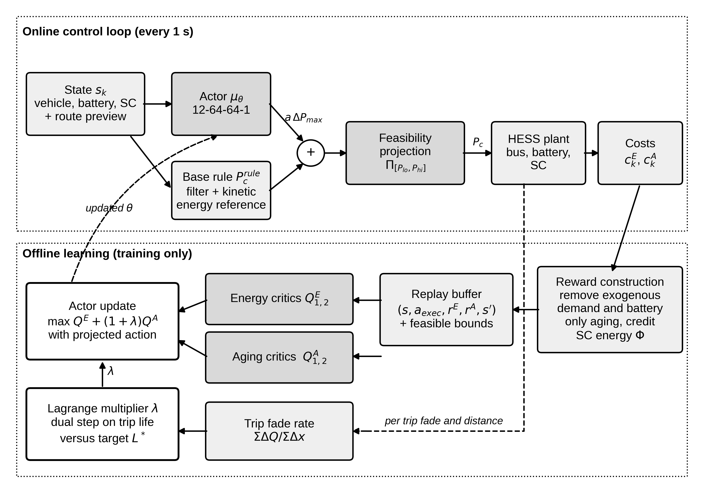

# SCOUT: degradation aware energy management for battery supercapacitor electric buses

Source code, data generators, trained policies and results for the paper

> S. Marisargunam and G. Arul Dalton, **Degradation Aware Reinforcement Learning for Battery Supercapacitor Energy Management in Electric Buses**, submitted to *Smart Grids and Sustainable Energy* (Springer), 2026.

SCOUT is a constrained twin delayed actor-critic energy management strategy that splits traction power between an LFP battery pack and a supercapacitor bank on a 12 m electric bus. It combines four elements:

- **Battery life budget.** Battery life is a constraint on severity-weighted charge throughput, enforced by an adaptive Lagrange multiplier acting on separate energy and aging critics.
- **Route preview residual.** A route-preview residual corrects a kinetic-energy-referenced frequency-split rule, within a ±60 kW trust region.
- **Projection-aware learning.** A feasibility projection is applied inside the actor and critic updates, not only in the plant.
- **Exact cost cancellation.** Policy-independent traction-demand energy and battery-only aging are cancelled from the rewards, and stored supercapacitor energy gets an undiscounted credit.

Everything is pure NumPy and runs on a single CPU core. No GPU is needed.



## Repository layout

| Path | Contents |
| --- | --- |
| `src/env.py` | Bus longitudinal dynamics, LFP pack (internal resistance, lumped thermal model, severity-factor aging after Suri and Onori 2016), supercapacitor bank, DC/DC converter, stochastic route generator |
| `src/agent.py` | NumPy MLP and Adam; TD3/DDPG with decomposed critics and projection-aware updates |
| `src/train.py` | All methods and ablations (`METHODS`), reward construction, training with validation checkpoint selection, test evaluation |
| `src/dp.py` | Rule baselines (BAT, LPF, RB-KE) and the offline dynamic programming benchmark |
| `src/analysis.py` | Tables 3 to 5 (`results/summary.json`) and Figs. 3 to 6 |
| `src/fleet.py` | Fleet-level grid energy and battery capacity analysis (Table 6) |
| `src/diagrams.py` | Block diagrams (Figs. 1 and 2) |
| `results/` | Per-run metrics, training histories and trained actors for every run in the paper (`<method>_<seed>.pkl`), baselines and DP (`baselines.pkl`) |
| `figures/` | All figures at 600 dpi |
| `run_all.sh` | Reproduces every result from scratch |

## Quick start

```bash
git clone https://github.com/GArulDalton/scout-hess-ebus.git
cd scout-hess-ebus
pip install -r requirements.txt

# reproduce the tables and figures from the stored results (seconds)
cd src && python analysis.py && python fleet.py

# retrain one policy (about 4 min on one CPU core)
python train.py SCOUT 0

# reproduce everything from scratch (about 1.5 h)
cd .. && ./run_all.sh
```

Available methods: `SCOUT`, `TD3`, `TD3-E`, `DDPG` and the ablations `SCOUT-noPrev`, `SCOUT-noRes`, `SCOUT-noLag`, `SCOUT-noProj` and `SCOUT-noShape`. Training, validation and test route seeds are disjoint.

## Main results (mean over six held-out route and climate cases)

| Method | Cost (USD/km) | Energy (kWh/km) | Battery life (10³ km) |
| --- | --- | --- | --- |
| Battery only | 0.2831 | 1.267 | 225 |
| RB-KE rule | 0.2458 | 1.339 | 381 |
| DDPG | 0.2506 | 1.322 | 339 |
| TD3 | 0.2671 | 1.337 | 277 |
| **SCOUT** | **0.2444** | 1.322 | 362 |
| DP (offline bound) | 0.2336 | 1.287 | 410 |

SCOUT is the cheapest online strategy. Its gain over the well-tuned rule is modest (0.6 % on average, up to 1.9 % at 40 °C), and the offline DP optimum shows the remaining headroom. See the paper for the full discussion and limitations.

## Model notes

The aging model takes the functional form of Suri and Onori (2016). Its scale is calibrated to 3500 equivalent full cycles to 80 % capacity at 1C, 25 °C and 50 % SOC. Driving cycles come from a stochastic route generator (urban, suburban and hilly families) rather than from recorded bus data.

## Citation

See `CITATION.cff`. Please cite the paper if you use this code.

## Licence

MIT, see `LICENSE`.
